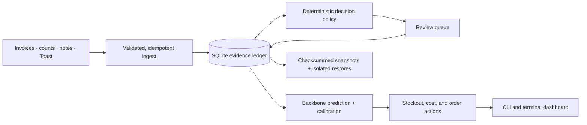

# Bars Bookkeeper

[](https://github.com/theos2node/BarsBookkeeper-Version-3/actions/workflows/ci.yml)
[](https://nodejs.org/)
[](LICENSE)

Local-first inventory intelligence and purchasing workflows for bars. Bars
Bookkeeper turns invoices, Toast sales, and sparse hand counts into an
auditable SQLite inventory ledger, then produces forecasts, reviewable
decisions, and order recommendations through a terminal UI.

Version 3 is an early public release candidate. Use backups, review generated
actions, and test live integrations against a non-production data directory
before relying on them operationally.

## What it does

- Imports vendor invoices, inventory counts, rough manager notes, and Toast
  order data.
- Preserves source evidence and idempotency keys in a local SQLite ledger.
- Maps menu items and modifiers to ingredient consumption.
- Predicts on-hand inventory, uncertainty ranges, stockout probability, and
  days remaining.
- Learns calibration corrections from later evidence-backed hand counts.
- Builds vendor-aware purchase recommendations from as-of pricing and lead
  times.
- Queues decisions for review and records application, reversal, and audit
  history.
- Runs deterministic simulations, rolling backtests, health gates, verified
  snapshots, and isolated restore drills.
- Provides a full-screen terminal dashboard without requiring a hosted
  service.

## Requirements

- Node.js 24 or newer
- npm 11 or newer
- macOS or Linux
- Optional: a Toast integration
- Optional: the authenticated Codex CLI for model-written reasoning summaries

The inventory engine, forecasts, review workflow, and simulations run without
Codex or any remote model.

## Quick start

```sh
git clone https://github.com/theos2node/BarsBookkeeper-Version-3.git
cd BarsBookkeeper-Version-3
cp .env.example .env.local
npm ci
npm run build
npm run bbk -- setup
npm run bbk -- seed-field-demo
npm run bbk -- console
```

`.env.local` and the default `data/` directory are ignored by Git. Keep
`.env.local` private:

```sh
chmod 600 .env.local
```

To expose the built binary globally while developing:

```sh
npm link
bbk --version
bbk doctor
```

Run `bbk --help` or `npm run bbk -- --help` for the complete command list.

## Core workflow

```sh
# Validate the installation and initialize the database.
npm run bbk -- doctor
npm run bbk -- setup

# Import evidence.
npm run bbk -- ingest invoice ./invoice.csv
npm run bbk -- ingest count ./count.csv
npm run bbk -- ingest note "House Vodka 1L 4.5 bottles; Lime Juice 1250 ml" --dry-run

# Generate reasoning, predictions, and orders.
npm run bbk -- brain run
npm run bbk -- backbone run --horizon-days 7
npm run bbk -- backbone actions
npm run bbk -- orders generate

# Review proposed inventory mutations.
npm run bbk -- review
npm run bbk -- review apply 42
npm run bbk -- review reverse 42
```

Use `--dry-run` for rough notes before importing. Bottle quantities use the
active vendor pack size for the matched SKU.

### Import formats

Invoice CSV rows require `vendor`, `invoiceNumber`, `invoiceDate`, `sku`,
`quantity`, `unit`, and either `unitCost` or `totalCost`. `quantity` is the
delivered inventory amount. Optional `packSize` and `packUnit` columns update
the vendor catalog used for order rounding; Bars Bookkeeper never guesses pack
size from shipment quantity.

An invoice number or count ID may repeat across multiple SKU rows. Each line
receives a stable content identity, so reordering and replaying the same file
does not duplicate or drop evidence. Malformed quotes, duplicate CSV headers,
and uneven rows fail before ingest.

## Architecture



The CLI and TUI orchestrate modules; they do not own business rules. The
database layer applies checksummed migrations, inventory mutations use
transactions, listener ownership uses an atomic lease, and later count
evidence calibrates predictions without rewriting history.

See [Architecture](docs/architecture.md) for module boundaries, invariants,
and data flow.

## Local data and privacy

`BBK_DATA_DIR` defaults to `./data`. It contains operational data and must
never be committed:

```text
data/
├── barsbookkeeper.sqlite
├── backups/
├── environments/
├── files/
├── launchd/
├── logs/
├── openclaw-usage.json
└── toast-config.json
```

Bars Bookkeeper has no telemetry service. Imported documents, restaurant
identifiers, inventory events, model summaries, logs, and backups stay in the
configured data directory unless an operator deliberately sends data to
Toast or enables the Codex integration.

`toast-config.json` stores only non-secret connection settings. Toast API keys
and client secrets are accepted only through environment variables or
permission-restricted secret files. Secret command-line flags are rejected.
Codex prompts are sent through standard input instead of process arguments
and model calls run ephemerally in a read-only sandbox. The Codex subprocess
receives only an operating-system environment allowlist; Toast credentials and
Bars Bookkeeper configuration are not inherited.

Read [Security model](docs/security-model.md) before connecting production
data. Report vulnerabilities through the process in [SECURITY.md](SECURITY.md).

## Configuration

Bars Bookkeeper loads `.env.local` and then `.env` from the working directory.
Already-exported environment values take precedence. Set `BBK_ENV_FILE` to
load one explicit file instead.

Common settings:

```dotenv
BBK_DATA_DIR=./data
BBK_SKIP_MODEL_SMOKE=1

OPENCLAW_USE_CODEX=0
OPENCLAW_LOGIC_MODEL=gpt-5.4
OPENCLAW_LOGIC_REASONING_EFFORT=low
OPENCLAW_FAST_MODEL=gpt-5.4-mini
OPENCLAW_FAST_REASONING_EFFORT=low
```

Invalid reasoning levels and unsafe filesystem-root data directories fail
closed rather than silently falling back.

## Toast integration

Configure Toast with environment variables:

```dotenv
TOAST_API_HOST=https://ws-api.toasttab.com
TOAST_AUTH_PATH=/authentication/v1/authentication/login
TOAST_SALES_PATH=/orders/v2/ordersBulk
TOAST_RESTAURANT_EXTERNAL_IDS=restaurant-id-1,restaurant-id-2
TOAST_CLIENT_ID=client-id
TOAST_CLIENT_SECRET_FILE=/run/secrets/toast-client-secret
```

On macOS and Linux, a secret file must have mode `0600`:

```sh
chmod 600 /run/secrets/toast-client-secret
npm run bbk -- toast connect
npm run bbk -- toast pull --start 2026-05-10T00:00:00Z --end 2026-05-11T00:00:00Z
```

For offline development, import an exported Toast payload:

```sh
npm run bbk -- toast pull --file ./toast-orders.json
npm run bbk -- toast map-recipe "House Martini" "House Vodka 1L" 75 ml
```

API pulls require HTTPS except for loopback test servers. Multi-restaurant
pulls retry transient failures, retain successful rows, and advance the Toast
cursor only after a complete pull. Replayed rows are ignored through stable
content-derived identifiers.

## Backbone operations

The Backbone layer projects inventory from timestamped purchases,
consumption, corrections, vendor prices, and count evidence. It records each
run, prediction, uncertainty band, and later scoring result.

```sh
npm run bbk -- backbone plan --horizons 1,7,14,30
npm run bbk -- backbone status
npm run bbk -- backbone gaps
npm run bbk -- backbone explain --sku "House Vodka 1L"
npm run bbk -- backbone accuracy
npm run bbk -- backbone drift
npm run bbk -- backbone trust
```

For continuous operation:

```sh
npm run bbk -- backbone listen
npm run bbk -- backbone listen --once
npm run bbk -- backbone listen --skip-openclaw
```

Only one listener can own a database at a time. The atomic runtime lease
prevents concurrent workers from double-processing a cycle and permits
takeover after the heartbeat expires.

For isolated validation:

```sh
npm run bbk -- backbone simulate --env steady-lab --scenario steady --days 30
npm run bbk -- backbone backtest --env rolling-lab --scenario volatile --days 60
npm run bbk -- backbone verify --env release-gate --days 60
npm run bbk -- backbone acceptance --env restore-drill --days 60
```

Simulation environments get separate databases under
`data/environments/<name>/`; they do not mutate the base database.

## Backups and restore drills

```sh
npm run bbk -- backbone snapshot --label before-change
npm run bbk -- backbone snapshot-verify --label before-change
npm run bbk -- backbone snapshot-restore --label before-change --env restore-check
```

A snapshot includes a SQLite copy, a SHA-256 digest, schema version, operational
counts, and a health manifest. Verification checks the digest and SQLite
integrity without opening or mutating the stored artifact. Restore targets are
isolated environments by design; the command never overwrites the base
database.

`bbk backbone maintain` creates and verifies a snapshot before its audit and
data-gap gates:

```sh
npm run bbk -- backbone maintain
npm run bbk -- backbone maintain --verify
npm run bbk -- backbone maintain-history
```

## Deployment

The application remains local-first; “deployment” means running the CLI and
listener reproducibly on an operator-controlled machine.

Supported examples are included for:

- a multi-stage, non-root [Dockerfile](Dockerfile);
- hardened Linux [systemd units](deploy/systemd);
- generated per-user macOS LaunchAgents through `bbk backbone service` and
  `bbk backbone maintain-service`.

See [Deployment](docs/deployment.md) for installation, secret handling,
volumes, health checks, upgrades, and rollback.

## Optional Codex summaries

`bbk brain run` uses deterministic policy rules by default. To add a concise
model-written summary, install and authenticate the Codex CLI, then opt in:

```sh
codex login
OPENCLAW_USE_CODEX=1 npm run bbk -- brain run
```

Bars Bookkeeper does not store an OpenAI API key. Codex prompts are passed over
standard input, invocations are ephemeral, project rules are ignored, and the
CLI sandbox is read-only. Usage and cost displays are local estimates based on
character counts and operator-configured rates, not billing records. Rates
default to zero until configured.

## Development

```sh
npm ci
npm run check
npm run test:coverage
npm audit
```

`npm run check` runs linting, strict type-checking, deterministic tests, the
production build, and a package dry run. CI repeats the release gate on Node.js
24 for Linux and macOS.

The test suite covers the CLI workflow, replay safety, malformed ingest,
Toast retry behavior, secret handling, migration integrity, concurrent
runtime leases, concurrent usage accounting, snapshot restore, model-prompt
privacy, hostile TUI text, simulations, and decision review.

Read [CONTRIBUTING.md](CONTRIBUTING.md) before submitting changes. Notable
changes are tracked in [CHANGELOG.md](CHANGELOG.md).

## License

MIT © Bars Bookkeeper contributors.
